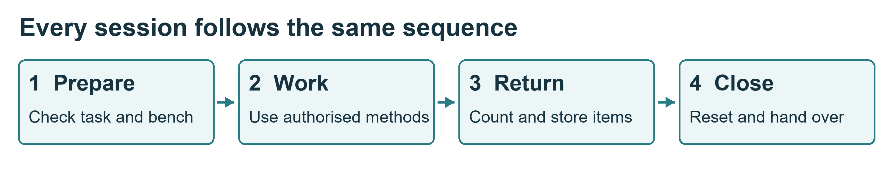

# Daily laboratory rules

These rules apply throughout every supervised Quiver session. A clean bench and a correct return are part of the work, not an optional extra.

## The rules students follow

1. Sign in, identify your supervisor and confirm your permitted task. Do not work alone on batteries, powered hardware or workshop equipment.
2. Inspect your bench and equipment before use. Report damage or missing items before starting.
3. Remove every propeller for bench work. Disarming does not remove electrical energy.
4. Isolate all supplies before changing wiring, tools or payloads. Include USB and test supplies.
5. Use only equipment for which you have recorded authorisation. Keep guards and protection in place.
6. Take components only from the assigned, labelled storage. Record controlled tools and parts issued to you.
7. Keep small parts in trays. Keep usable, unfinished and rejected items separate.
8. Keep food, drinks, bags and loose objects away from work surfaces. Leave exits and walkways clear.
9. Follow the battery procedure. Only the authorised electrical supervisor controls charging, connection and first power-up.
10. Stop for smoke, unexpected heat, unusual movement, a damaged cable or an unclear instruction.
11. Report faults, injuries and near misses promptly. Never return a defective item to usable stock.
12. Before leaving, return and account for items, clean the bench, save files and complete the shutdown or handover.

## What good practice looks like

You finish a wiring task with two spare connectors. Check their part numbers, confirm they are clean and undamaged, return them to the correct bins and update the issue record. Put an unidentified connector in the labelled review tray and tell the stores lead. Do not guess its bin.

## Practise and show

Prepare a bench with a parts tray, an approved job sheet and only the tools needed. Explain how you would deal with a missing tool and a damaged connector.

**Pass evidence:** the instructor sees correct preparation and a complete return and reset. See sources S1, S2 and S3 in [References](references.md).

