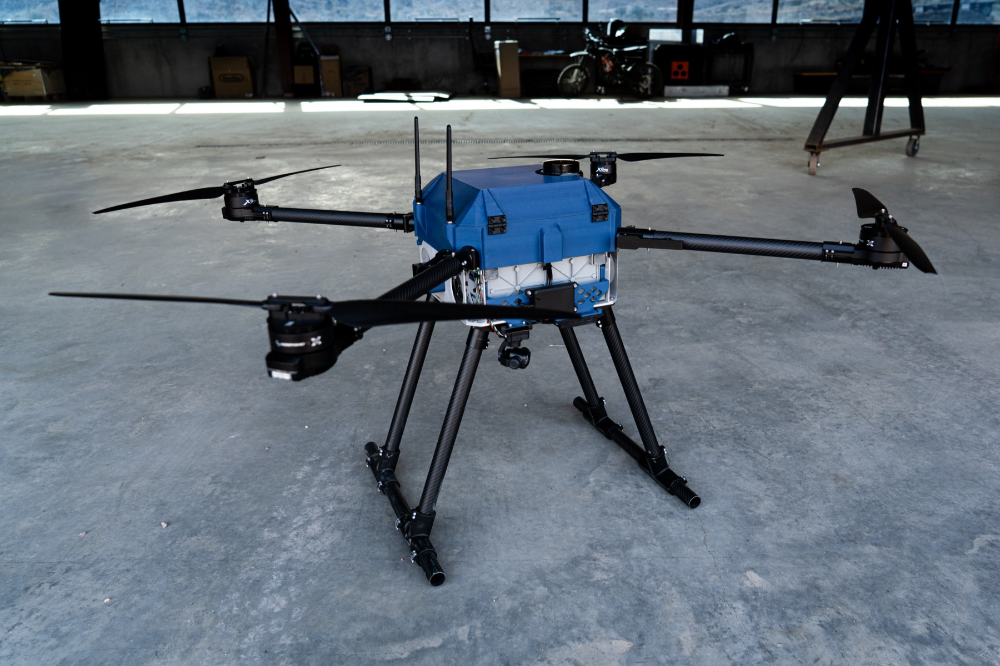

# Quiver student laboratory handbook

This course teaches students how to use the UNILAG AI UniPod safely, care for shared equipment and complete a supervised build. Use it at the bench: find the activity, follow its procedure and ask the supervisor when a condition is unclear.

Start with the [daily rules](daily-rules.md). Complete the common induction before joining one of the six build teams. Your supervisor records the equipment and activities you are authorised to use.

  <a href="daily-rules/">Start the induction</a>
  <a href="daily-checklist/">Open the daily checklist</a>
  <a href="downloads/Quiver_Student_Laboratory_Handbook_v1.docx" download>Download the Word handbook</a>

*Reference photo shows Quiver aircraft. All propellers must be removed for classroom and bench work.*

## How to use this handbook

- Read the daily rules before your first session.
- Learn the actual locations of storage, exits, emergency contacts and isolation controls.
- Watch the instructor demonstrate each assigned activity, then practise under supervision.
- Use the opening and closing checklists every day.
- Keep your own evidence and sign-off records, even when working in a team.

## What you will be able to do

Identify hazards and isolate equipment; manage tools and components; use authorised lab equipment; explain Quiver's systems; build or configure an assigned subsystem; run a simulation and explain its limits; hand over traceable work.

## Find the right section

- **Every day:** [access](access.md), [opening and isolation](opening.md), [storage](storage.md) and [closing](closing.md).
- **At your workstation:** [batteries](batteries.md), [charging and storage](charging.md), [computers](computers.md), [electronics](electronics.md), [tools and soldering](tools.md), [3D printing](printing.md) and [aircraft handling](aircraft.md).
- **If something goes wrong:** [faults and emergencies](incidents.md).
- **Build and demonstrate:** [systems](systems.md), [SITL](sitl.md), [team work](teams.md), [integration](integration.md) and [assessment](assessment.md).
- **Records:** [daily checklist](daily-checklist.md), [equipment record](equipment-record.md) and [technical work record](work-record.md).

<!-- **Course control:** Version 5.1, 25 October 2026. The department must adopt the procedures and complete the local arrangements in the [delivery guide](delivery.md) before practical teaching. Equipment authorisation and real flight approval are separate decisions. -->

