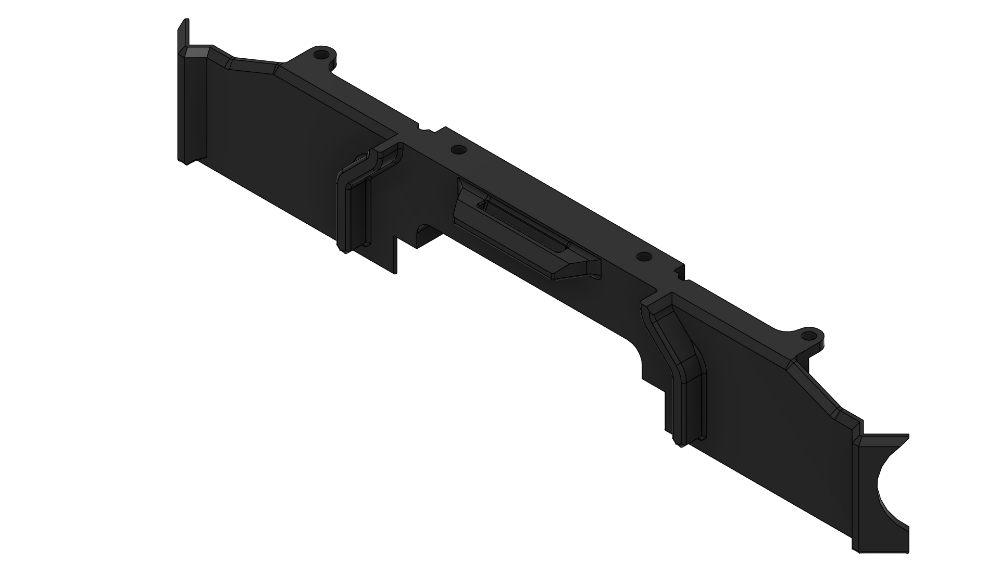

# Printing a Quiver part on the Bambu Lab P2S

**Your outcome:** prepare an approved job, observe it safely and inspect the finished part.

*Training example: Quiver 2313 battery connector PCB cover. Project image; inspect the approved CAD revision before printing.*

## Before pressing print

1. Identify the **Bambu Lab P2S**, its pause/stop controls and trained supervisor. Check cables, build area and enclosure.
2. Confirm the approved ventilation and material. Air conditioning alone does not establish control of printing emissions.
3. Open the released **2313** model in **Bambu Studio**. Select P2S and the installed nozzle, build plate and filament. The BOM specifies PETG-CF; staff must verify material and nozzle compatibility.
4. Check orientation, supports, build-volume fit and the sliced Preview. Save a `.3mf` job with the part revision and profile. Staff approve it before printing. Never scale a part merely to fit.

## During the job

Watch the first layer. Keep hands clear of the P2S toolhead, heated bed and moving mechanisms. For poor adhesion or a filament tangle, pause/stop and call the supervisor; do not reach inside during motion or defeat interlocks. Nozzle changes require separate training.

For smoke or fire, raise the alarm and withdraw. Do not open the enclosure to investigate. An unattended job requires the laboratory's explicit written arrangement.

## After the job

Allow the bed and part to cool. Remove the plate/part using its approved method. Inspect the 2313 mounting holes, edges, warping and layer bonding against the drawing.

Label accepted parts with identity and revision; put rejected parts in review. Appearance alone cannot prove flight suitability. After a power interruption, a technician releases the printer and the instructor reviews any resumed structural print.

