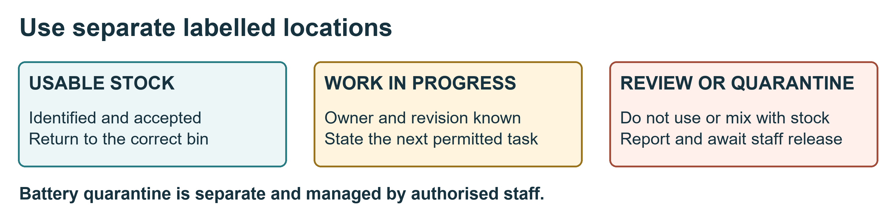

# Components tools and labelled storage

**Your outcome:** take, track and return items without mixing parts or hiding defects.

## Take an item

1. Read the cabinet and bin labels. Use only storage assigned to your team.
2. Match the part number, size, rating and revision to the job sheet. Look at the container label, not only the appearance.
3. Check condition and quantity. Record controlled items before removing them: item ID, quantity, student, team, date and destination bench.
4. Put small components in a labelled tray or suitable protective packaging. Keep boards in approved ESD packaging.
5. Close drawers and cabinets. Do not leave parts on the floor or in walkways.

## Keep three states separate

- **Usable stock:** identified, accepted items in their correct bins.
- **Work in progress:** an assembly or part awaiting work or inspection, labelled with team, owner, revision, status and date.
- **Quarantine or review:** damaged, suspect or unidentified items held outside usable stock.

The diagram shows an example layout. The lab manager assigns the actual locations. Damaged batteries follow the specialist battery procedure; they do not go into the ordinary parts quarantine tray.

## Return an item

Remove debris using the approved method; inspect condition; count what remains; return accepted parts to the exact bin; update the issue record. Return leads to their rack and keep probes with their instrument. Report consumables used and tools or components that cannot be accounted for.

Do not mix similar screws, connector variants or component ratings. Do not silently substitute another item. Put uncertain parts in review and ask the stores lead.

## Practise and show

Sort **2111 side attachment spacers** and **2131 bottom spacers** into their own labelled bins. Keep **3112 CW** and **3122 CCW** propellers separately labelled and off the aircraft. Record one issue/return and route an unidentified spacer to review.

**Pass evidence:** correct identification, traceable quantity and correct storage location. Sources S1, S2 and S3.

