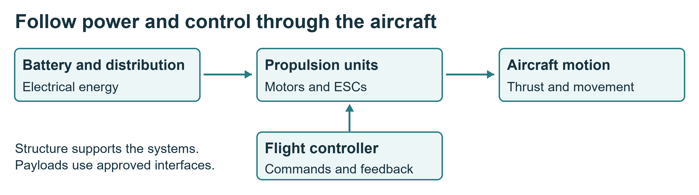

# Understanding Quiver systems

**Your outcome:** identify the major subsystems and explain how power and commands reach the motors and payload.

Quiver combines an airframe, propulsion assemblies, custom interface and power boards, flight-control hardware, sensors and software. The course uses the documented project as a reference; the issued kit must be checked against the approved release.

## Recognise the components

- **Structure:** frame, landing gear, arm attachments and supporting mounts.
- **Powertrain:** motors, electronic speed controllers or integrated propulsion units, arm joints and the removed propellers.
- **Power and wiring:** battery interfaces, distribution, protection, connectors and harnesses.
- **Avionics:** flight controller, sensors and communication hardware.
- **Payloads:** bottom and side attachment hardware, enclosure and associated electrical/data interfaces.
- **Software:** flight firmware, parameters, ground software and simulation.

The Pix32 V6 is a flight-controller module, not a single chip. ArduPilot is firmware that runs on compatible flight-control hardware; in SITL, flight-control software runs on a computer with a simulated vehicle.

## Find the right project file

Use the selected BOM and manufacturing drawings to identify parts. Use harness drawings and board documentation for connector identity and pinout. Use firmware documentation only after the physical board and firmware target have been verified.

The reference repository includes attachment-interface CAD under `src/quiver/supporting_structure/attachment_interface`. A drawing image is not a load rating or an approved manufacturing specification.

## Practise and show

On the isolated assembly or labelled photographs, point to each subsystem. Trace one power path and one control path. Identify where your team's work meets two other teams.

**Evidence:** a labelled system sketch and a short explanation of one interface. See project sources P1 to P5 in [Project references](project-references.md).

