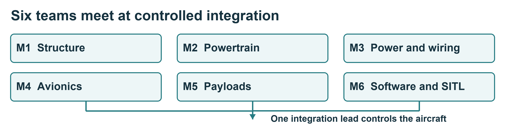

# Organising parallel build work

**Your outcome:** know what your team owns and what must be agreed before it connects to another team's work.

## Six team responsibilities

| Team | Main work | Handover |
| --- | --- | --- |
| M1 Structure | Frame, landing gear and fixed mounts | Fit and mounting records |
| M2 Powertrain | Motor arms, joints and propulsion units | Inspected assemblies and motor map |
| M3 Power and wiring | Power interfaces and harnesses | Pinout, polarity and inspection evidence |
| M4 Avionics | Controller, sensors and communications | Hardware and port map |
| M5 Payloads and enclosure | Attachments, quick release and covers | Retention, mass and interface record |
| M6 Software and SITL | Simulation and configuration | Repeatable setup, logs and limitations |

## Agree the work before starting

Use teams of two to four where supervision permits. Rotate builder, checker and recorder. The checker must be a different person from the builder.

Record the approved revision, required parts, task sequence, hazards, acceptance criteria and interfaces. Sending and receiving teams agree dimensions, connector identity, pinout, power/data requirements and test method. Missing values go to the engineering owner.

Teams may work on isolated subsystems in parallel. The integration lead controls the shared aircraft. No team may connect a supply, change wiring or upload settings during another team's work.

## Daily handover

State what was completed, where the evidence is saved, current isolation state, open defects and the next permitted activity. Keep individual evidence as well as the team record.

**Before building:** the instructor accepts the work plan and the applicable equipment authorisations. Open the work card for your team.

